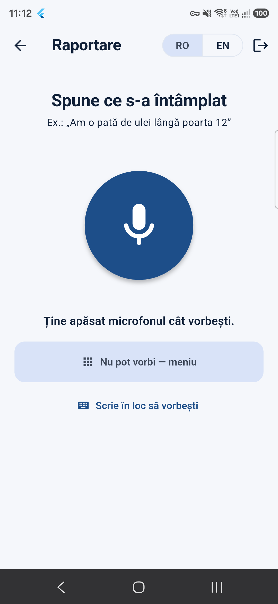
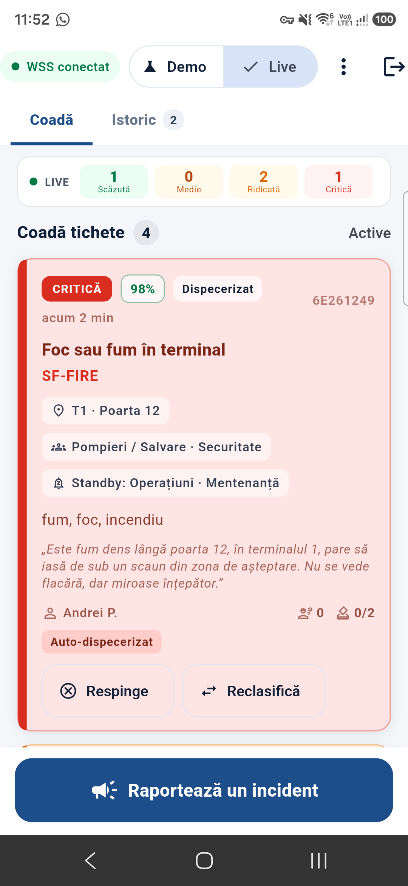
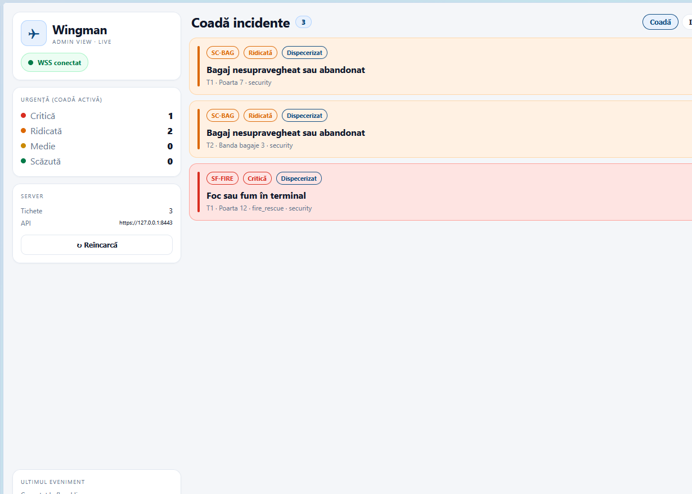

<div align="center">


# Wingman

**Airport incident response, without the radio chaos.**

One report. The right people. Live.

Flutter · FastAPI · local AI · SQLite · WebSocket

</div>

---

Wingman turns a hurried sentence into a coordinated response.

An airport employee reports an incident by **voice** or through a deterministic **8×8×8 menu**. The local AI classifies it, the backend picks **urgency and departments**, and the ticket appears instantly on the dispatcher control room and the right crew phones. Dispatchers can confirm, deny or reclassify. Crews join, vote and resolve. No cloud dependency, no radio guesswork.

<table>
  <tr>
    <td align="center"><br/><sub><b>Report it</b> — voice or 3-tap menu</sub></td>
    <td align="center"><br/><sub><b>Dispatch it</b> — live queue + AI code</sub></td>
    <td align="center"><br/><sub><b>Control room</b> — the same ticket, live</sub></td>
  </tr>
</table>

## Why it feels different

| | |
|---|---|
| **Local-first AI** | Whisper and Ollama run on the laptop. Reports stay on the local network. |
| **Human-safe classification** | Closed taxonomy, schema validation, deterministic keyword guards and a fallback classifier. The AI cannot invent an incident code. |
| **Honest Whisper** | Low-confidence speech gets **one** repeat, never a loop. Still unclear? The app switches to the deterministic 8×8×8 menu. |
| **Department-aware dispatch** | Notifications go only to the departments the incident actually needs. Standby teams are not woken for nothing. |
| **One ticket, many reporters** | Duplicate reports merge into one ticket, increment the report count and keep the distinct reporters visible with a 👥 counter. |
| **Real persistence** | Tickets, photos, votes and history live in SQLite and survive backend restarts. |
| **Live everywhere** | One WSS connection keeps phones and the control room in sync, with a versioned `TicketBoard` cache. |
| **Statistics that mean something** | What happens, how often, and where — by day, week, month or year. |
| **Rewards with a spine** | 2 points for a report, 5 for join + resolve. Self-report → self-resolve on a non-dangerous incident earns **0**. |
| **Location-aware** | The signed-in app requires location on and a position within **2 km** of the airport. GPS-off and known out-of-range are hard locks; no-fix indoors offers an explicit continue. |

## A 30-second tour

1. **Report** — hold the mic and describe the incident, or use the menu: 8 categories × 8 subcategories × 8 problems = **512 combinations**.
2. **Understand** — Whisper transcribes locally; Ollama classifies into a closed 16-type taxonomy; the app asks only for a missing type or location.
3. **Dispatch** — the ticket is immediately visible in the control room with urgency, location, required teams and an AI rationale.
4. **Respond** — the relevant crew phone gets a department-scoped notification. Crew members join, vote and resolve through the configured quorum.
5. **Learn** — statistics, history, account points and reporter counts stay live across the whole system.

## Under the hood

```text
 reporter phone                 crew phones
  voice / 8×8×8 menu                  ▲
        │                             │ WSS ticket.*
        ▼                             │ + department-scoped notifications
  FastAPI :8443 ── Ollama qwen2.5 ──▶ classification + urgency + departments
        │          faster-whisper ──▶ local speech-to-text
        ▼
  SQLite wingman.db ◀── write-through ── status · join · vote · resolve
        │
        ▼
  Waterfox control room: live queue · actions · statistics
```

**Stack:** Flutter/Dart · FastAPI/Python · SQLite · Ollama · faster-whisper · WebSocket · flutter_map + OpenStreetMap · TLS with a pinned local CA · image_picker.

## Quick start

```powershell
# 1) backend: HTTPS + WSS on :8443, SQLite auto-created
cd backend
.\run.ps1

# 2) demo data + full smoke test
cd ..
python backend\seed_demo.py
python scripts\smoke_test.py --ca backend\certs\ca.crt

# 3) Android app (built with the laptop API address)
.\scripts\build_demo_apks.ps1 -ApiHost <LAPTOP_IP>
adb install -r D:\Hackathon\dist\wingman-tls-release.apk

# 4) desktop control room
.\scripts\serve_dashboard.ps1

# 5) every quality gate
.\scripts\verify_all.ps1 -Live
```

The database lives at `backend/data/wingman.db`. It is created automatically, git-ignored, and is **not** wiped by a backend restart. `POST /api/dev/reset` clears both memory and the database for a rehearsal.

## Demo accounts

Anyone can report — there is no separate reporter account. The account scope decides who receives alerts.

| Account | Password | Scope |
|---|---|---|
| **Andy Admin** | `admin123` | everything + dispatcher |
| **Earl Engineer** | `engineer123` | maintenance · IT · baggage · airside |
| **John Janitor** | `janitor123` | terminal services |
| **Fred Firefighter** | `firefighter123` | fire / rescue |
| **Gina Guard** | `guard123` | security |
| **Mandy Medic** | `medic123` | medical |

## Project map

```text
Wingman/
├── lib/
│   ├── core/                 contracts and shared infrastructure
│   │   ├── api/              REST + WSS client, pinned TLS
│   │   ├── location/         2 km airport geofence lock
│   │   ├── models/           Ticket, Session, stats, transcription
│   │   ├── state/            TicketBoard (snapshot + WSS merge)
│   │   ├── domain/           domain profiles, quorum
│   │   ├── rewards/          reward policy + ledger
│   │   ├── incidents/        closed taxonomy (16 types)
│   │   └── notifications/    department-scoped local alerts
│   └── features/
│       ├── reporter/         voice/typed flow · 8×8×8 menu · photo/GPS
│       ├── dispatcher/       live queue · history · statistics
│       ├── crew/             scoped queue · join · vote · retract
│       ├── rewards/          account ledger
│       └── auth/             demo account chooser
├── backend/
│   ├── app/                  FastAPI routes, store, ai, stt, stats, database
│   ├── data/wingman.db       SQLite runtime database
│   ├── seed_demo.py          rehearsal tickets
│   └── run.ps1               TLS server on :8443
├── config/domains/           airport + alternate domain profiles
├── scripts/                  certs, builds, dashboard, smoke, gates
├── docs/                     screenshots and deep dives
└── test/                     contract, policy and widget tests
```

## API at a glance

| Method | Path | Purpose |
|---|---|---|
| `POST` | `/api/transcribe` | Local Whisper STT, word confidences, one safe LLM correction |
| `POST` | `/api/analyze` | One conversational turn: fields, missing slots, next question |
| `POST` | `/api/reports` | Create a ticket from voice or menu |
| `GET` | `/api/tickets` | Live queue / history |
| `POST` | `/api/tickets/{id}/confirm` · `/deny` · `/override` | Dispatcher decisions |
| `POST` | `/api/tickets/{id}/join` · `/vote` · `/leave` | Crew actions |
| `GET` | `/api/stats` | Admin statistics (`day`, `week`, `month`, `year`) |
| `GET` | `/healthz` | Backend + SQLite health |
| `WS` | `/ws?token=` | Live `ticket.*` events |

## Quality

- **190 Flutter tests**
- **22 backend tests**
- **108/108** live smoke checks (TLS + WSS)
- `flutter analyze` clean
- `.\scripts\verify_all.ps1 -Live` → all gates

## Documentation

| Doc | What it covers |
|---|---|
| [docs/demo-script.md](docs/demo-script.md) | 3-minute rehearsal + fallbacks |
| [docs/modularity.md](docs/modularity.md) | Domain profiles and policy modules |
| [docs/reporter.md](docs/reporter.md) | Voice flow, confidence handling, menu fallback |
| [docs/certs-and-phones.md](docs/certs-and-phones.md) | CA, TLS and phone setup |
| [docs/laptop-setup.md](docs/laptop-setup.md) | Toolchain, network, firewall |
| [docs/design-tokens.md](docs/design-tokens.md) | The Wingman design system |
| [docs/progress.md](docs/progress.md) | Build log and evidence |
| [CONTRACTS.md](CONTRACTS.md) | Frozen Dart ↔ FastAPI wire contracts |

---

<div align="center">
<sub>Built for the airport floor: fast to report, clear to dispatch, honest about uncertainty.</sub>
</div>
